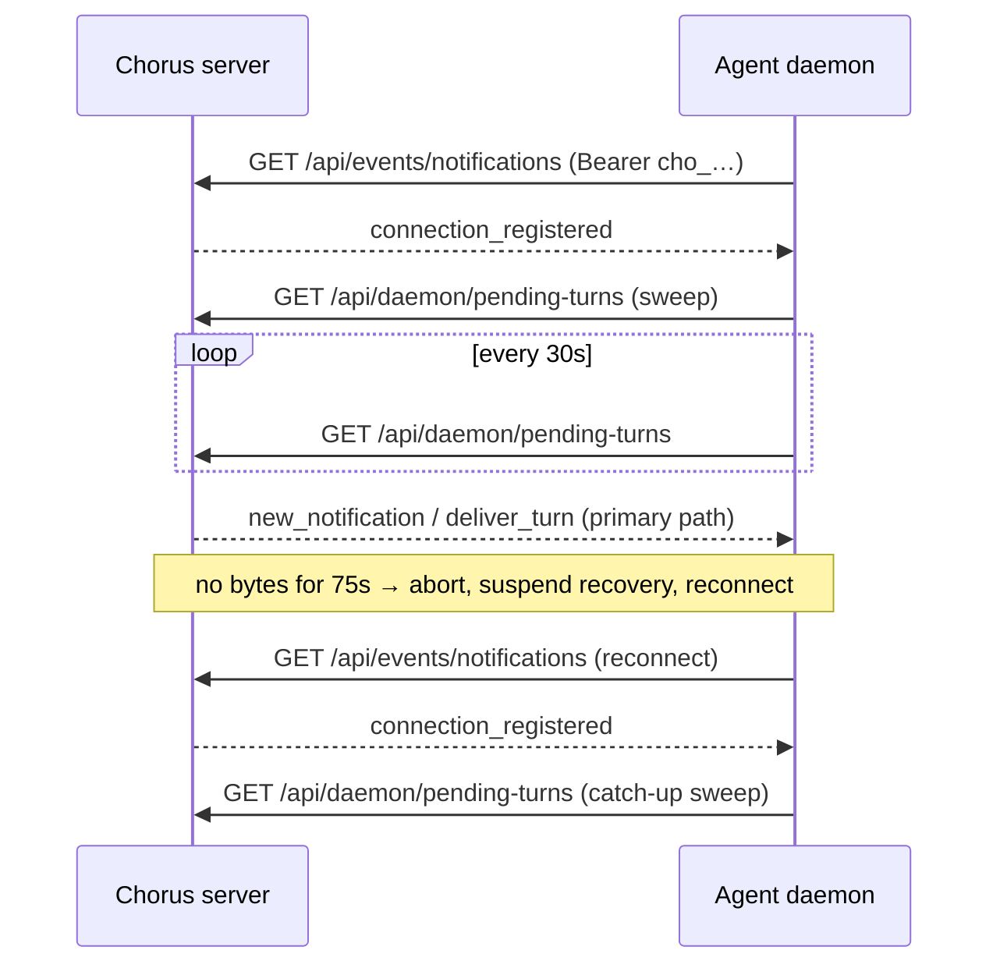

# SSE Real-Time UI Updates

## Overview

When AI Agents modify Chorus data through MCP tools (moving task status, claiming ideas, approving proposals, etc.), the browser UI automatically updates without requiring a manual page refresh. This is achieved through an in-memory Event Bus combined with Server-Sent Events (SSE).

## Architecture

```
Agent/User → MCP Tool / Server Action / API Route
                        ↓
               Service Layer (mutation)
                        ↓ eventBus.emitChange()
              EventBus (in-memory EventEmitter singleton)
                        ↓
              SSE API Route (GET /api/events)
              ↓ filtered by companyUuid + projectUuid
              Browser EventSource
                        ↓ debounced (500ms)
              router.refresh() → Server Component re-fetches data → new props flow into client components
```

## Components

### 1. Event Bus — `src/lib/event-bus.ts`

A process-level singleton built on Node.js `EventEmitter`. Every service-layer mutation emits a `RealtimeEvent` after the database operation completes.

```typescript
interface RealtimeEvent {
  companyUuid: string;     // Multi-tenant isolation
  projectUuid: string;     // Project-level filtering
  entityType: "task" | "idea" | "proposal" | "document";
  entityUuid: string;      // The specific entity that changed
  action: "created" | "updated" | "deleted";
}
```

The event bus is a simple in-memory mechanism. For multi-instance deployments, it can be replaced with Redis pub/sub — the SSE endpoint and client code remain unchanged.

### 2. SSE Endpoint — `src/app/api/events/route.ts`

A Next.js Route Handler that streams server-sent events to the browser.

- **URL**: `GET /api/events?projectUuid=<uuid>`
- **Auth**: Uses `getAuthContext(request)` — browser cookies are automatically sent by `EventSource`
- **Filtering**: Events are filtered by `companyUuid` (from auth context) and optionally by `projectUuid` (from query param)
- **Heartbeat**: Sends a `: heartbeat\n\n` comment every 30 seconds to keep the connection alive
- **Cleanup**: When the client disconnects (`request.signal` abort), the event listener and heartbeat timer are removed
- **Headers**: `Content-Type: text/event-stream`, `Cache-Control: no-cache`, `Connection: keep-alive`
- **Caching**: `export const dynamic = "force-dynamic"` prevents Next.js static caching

### 3. Client Hook — `src/hooks/use-realtime.ts`

A React hook that manages the `EventSource` connection and triggers UI refreshes.

```typescript
useRealtime(projectUuid: string)
```

**Behavior:**
- Creates an `EventSource` connection to `/api/events?projectUuid=<uuid>` on mount
- On receiving any message, debounces for 500ms then calls `router.refresh()`
- `router.refresh()` triggers Next.js Server Components to re-fetch data, which flows as new props into client components
- On tab visibility change: closes the connection when hidden, reconnects and refreshes when visible
- Cleans up on unmount (closes EventSource, clears timers, removes listeners)

**Why debounce?** A single operation like `approveProposal` can trigger multiple events (proposal update + batch task creation). The 500ms window collapses these into a single `router.refresh()` call.

### 4. Service Layer Event Emission

Each mutation function in the service layer calls `eventBus.emitChange()` after the database operation but before returning.

#### Task Service (`src/services/task.service.ts`)

| Function | Action | Event Data Source |
|----------|--------|-------------------|
| `createTask()` | `created` | `params.companyUuid`, `params.projectUuid` |
| `updateTask()` | `updated` | Prisma result includes `project` relation |
| `claimTask()` | `updated` | Prisma result includes `project` relation |
| `releaseTask()` | `updated` | Prisma result includes `project` relation |
| `deleteTask()` | `deleted` | Prisma `delete()` returns the deleted record |

#### Idea Service (`src/services/idea.service.ts`)

| Function | Action | Event Data Source |
|----------|--------|-------------------|
| `createIdea()` | `created` | `params.companyUuid`, `params.projectUuid` |
| `updateIdea()` | `updated` | Prisma result includes `project` relation |
| `claimIdea()` | `updated` | Prisma result includes `project` relation |
| `releaseIdea()` | `updated` | Prisma result includes `project` relation |
| `deleteIdea()` | `deleted` | Prisma `delete()` returns the deleted record |

#### Proposal Service (`src/services/proposal.service.ts`)

| Function | Action | Event Data Source |
|----------|--------|-------------------|
| `createProposal()` | `created` | `params.companyUuid`, `params.projectUuid` |
| `submitProposal()` | `updated` | Prisma result fields |
| `approveProposal()` | `updated` | Emitted after `$transaction` completes |
| `rejectProposal()` | `updated` | Prisma result fields |
| `closeProposal()` | `updated` | Prisma result fields |

#### Session Service (`src/services/session.service.ts`)

Session events are important for the worker badge indicators on the Kanban board.

| Function | Action | Entity Type | Notes |
|----------|--------|-------------|-------|
| `sessionCheckinToTask()` | `updated` | `task` | Uses task's `projectUuid` from validation query |
| `sessionCheckoutFromTask()` | `updated` | `task` | Queries task to get `projectUuid` |
| `closeSession()` | `updated` | `task` | Emits one event per active checkin being closed |

### 5. Client Component Integration

The `useRealtime()` hook is called in these client components:

| Component | File |
|-----------|------|
| `KanbanBoard` | `src/app/(dashboard)/projects/[uuid]/tasks/kanban-board.tsx` |
| `IdeasList` | `src/app/(dashboard)/projects/[uuid]/ideas/ideas-list.tsx` |
| `ProposalKanban` | `src/app/(dashboard)/projects/[uuid]/proposals/proposal-kanban.tsx` |

These components use Server Component data via props. When `router.refresh()` is called, Next.js re-runs the Server Component, which re-fetches data from the database, and the new props automatically flow into the client components.

## Multi-Tenancy

Events are scoped by `companyUuid`. The SSE endpoint filters events using the authenticated user's `companyUuid`, ensuring no cross-tenant data leakage. A user in Company A will never receive events from Company B.

## Agent Compatibility

Agents mutate data through the MCP endpoint (API Key + `Authorization` header), and those mutations trigger events pushed to browser users watching the same project.

Agents also **consume** SSE. The project stream above (`GET /api/events`) is browser-only, but the agent daemon subscribes to the user-scoped notification stream `GET /api/events/notifications`, and this is its primary wake channel.

### Two auth paths on the SSE endpoints

Both SSE routes authenticate with `getAuthContext(request)`, which checks a Bearer token before falling back to cookies (`src/lib/auth.ts`):

| Client | Transport | Auth |
|--------|-----------|------|
| Browser | `EventSource` | Session cookie, sent automatically |
| Agent daemon | `fetch` with a streamed response body | `Authorization: Bearer cho_…` + `Accept: text/event-stream` (`cli/sse-listener.mjs:140,165`) |

`EventSource` cannot set custom request headers, which is why the browser relies on the cookie. That limitation applies only to `EventSource`. The daemon is a Node process reading the stream with `fetch`, so it sends the Bearer API key like any other request.

### Pending-turns recovery (`GET /api/daemon/pending-turns`)

`GET /api/daemon/pending-turns?connectionUuid=…` (Bearer agent key) returns the `pending` (unstarted) turns of sessions whose origin is that daemon connection (`src/app/api/daemon/pending-turns/route.ts`). It is a **recovery path, not a replacement** for SSE: every turn is persisted in the turn table when it is created, so a wake whose SSE delivery was lost can still be re-derived from that table.

When the daemon reads it (`cli/delivery-recovery.mjs`, wired in `cli/daemon.mjs:490`):

1. **On (re)registration.** Every time the SSE handshake delivers `connection_registered`, the daemon calls `recovery.register()` (`cli/daemon.mjs:522`), which schedules an immediate sweep (`cli/delivery-recovery.mjs:110-120`).
2. **Periodically while connected.** After each sweep the next one is due 30s later (`intervalMs = 30_000`, `cli/delivery-recovery.mjs:5,47`), so lost deliveries are recovered even on a connection that never dropped (test: `cli/__tests__/delivery-recovery.test.mjs` "periodically reconciles protocol work on an otherwise healthy connection").
3. **On a live `deliver_turn` control ping.** The ping triggers a targeted read of only the announced turn, through the same sweep function (`cli/daemon.mjs:445`, `cli/backfill.mjs:202-209`).

How it relates to SSE disconnects:

- **Silent partition.** If the stream receives no bytes (data or the server's 30s `: heartbeat`) for 75s, the listener aborts it and reconnects (`WATCHDOG_TIMEOUT_MS = 75_000`, `cli/sse-listener.mjs:32,363-376`; test: `cli/__tests__/sse-silent-partition.integration.test.mjs`).
- **During reconnect** recovery is suspended (`onReconnect` → `recovery.suspend()`, `cli/daemon.mjs:556`). It resumes, starting with a sweep, as soon as the new connection is registered (step 1).



**Deduplication.** Each connection has one `seen` set shared by its live SSE router and its recovery reads (`cli/daemon.mjs:309-311`). Turns are keyed `turn:<turnUuid>` and notifications by their uuid. The router marks keys as seen and returns `duplicate` for any key it has already accepted (`cli/event-router.mjs:74-79,127-130`). The recovery path only pre-checks the set and leaves marking to the router (`cli/backfill.mjs:109-114,173-175`). A turn therefore runs at most once, whichever path sees it first (test: `cli/__tests__/backfill-pending-turns.test.mjs` "live deliver_turn (pendingTurnsOnly) then reconnect backfill share the seen set → turn handled at most once").

## Scaling Considerations

The current implementation uses an in-memory `EventEmitter`, which works for single-instance deployments. For multi-instance deployments:

1. Replace the `EventEmitter` with **Redis pub/sub**
2. Each instance subscribes to a Redis channel
3. When a mutation occurs, publish to Redis instead of emitting locally
4. Each instance's SSE endpoint receives the Redis message and pushes to connected browsers

The SSE endpoint API and client hook code remain unchanged — only the event bus implementation needs to swap.

## File Summary

| File | Type | Purpose |
|------|------|---------|
| `src/lib/event-bus.ts` | New | EventEmitter singleton with `RealtimeEvent` type |
| `src/app/api/events/route.ts` | New | SSE endpoint with auth, filtering, heartbeat |
| `src/hooks/use-realtime.ts` | New | Client EventSource hook with debounce + visibility |
| `src/services/task.service.ts` | Modified | 5 mutations emit events |
| `src/services/idea.service.ts` | Modified | 5 mutations emit events |
| `src/services/proposal.service.ts` | Modified | 5 mutations emit events |
| `src/services/session.service.ts` | Modified | 3 mutations emit events |
| `kanban-board.tsx` | Modified | Added `useRealtime(projectUuid)` |
| `ideas-list.tsx` | Modified | Added `useRealtime(projectUuid)` |
| `proposal-kanban.tsx` | Modified | Added `useRealtime(projectUuid)` |
